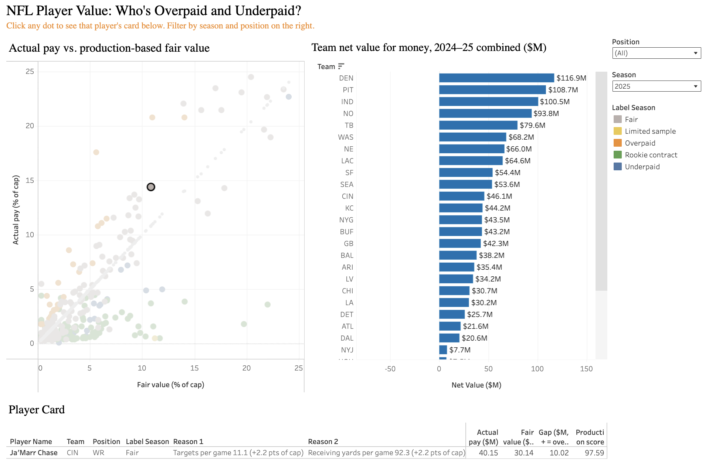

# NFL Player Value Model

Which NFL players (QB/RB/WR/TE) are overpaid or underpaid for their on-field production, 2019–2025.

**[Live Tableau dashboard](https://public.tableau.com/app/profile/varun.rayapati/viz/NFLPlayerValue/NFLPlayerValue)**



## Key findings

- **Model accuracy:** on the held-out 2024–2025 seasons (413 veteran player-seasons), XGBoost predicts contract
  size with **R² 0.753 and MAE 1.79 percentage points of the salary cap** (about $4.6M at the 2024 cap), compared
  with R² 0.702 / MAE 2.07 pp for a linear regression baseline.
- **Labels:** a player is Overpaid if their contract gap (actual pay minus model fair value) is in the top 15% within
  their position × pay tier **and** at least $2.5M; Underpaid is the mirror image. Result: **47 Overpaid, 52 Underpaid**
  and 313 Fair veteran player-seasons (plus 283 rookie contracts scored separately).
- **Teams (2024+2025 net value):** Denver gets the most production per dollar at **+$116.9M**; Cleveland is last at
  **−$41.1M**.
- **Standouts:** Deshaun Watson 2024 was paid $47.6M more than his production earned; Russell Wilson 2024 produced
  $48.8M more than his contract paid.

Every number above comes from code that was run; see [docs/RESULTS.md](docs/RESULTS.md) for the full results and
their sources.

## Approach

1. **Data:** nflverse play-by-play, weekly stats, snap counts and rosters via `nflreadpy`, plus OverTheCap contract
   history, seasons 2019–2025.
2. **Storage and features:** raw Parquet loaded into DuckDB; every feature table is built in SQL (`sql/01`–`08`).
3. **Production features (per game):** passing/rushing/receiving volume, EPA, CPOE and consistency, averaged over
   two seasons (2/3 current, 1/3 prior), plus availability (games played) and a 3-year durability measure.
4. **Model:** XGBoost predicts contract size as % of the salary cap, trained on veteran contracts only (rookie pay is
   set by draft slot, not performance). Time-based split: train 2019–2023, test 2024–2025. Compared against a
   linear regression and a position-average baseline.
5. **Explanation:** SHAP gives each player's top reasons for their fair value.
6. **Labels:** contract gaps ranked within position × pay tier, so stars are compared with stars.
7. **Dashboard:** CSVs in `exports/` feed the Tableau Public dashboard.

## Repo layout

```
pipeline/    ingest.py (download raw data), build_db.py (load into DuckDB)
sql/         feature tables, one .sql file per table, run in filename order
src/         features.py (runs the SQL), model.py (model, labels, shared code)
notebooks/   01_eda, 02_model, 03_value (v1), 04_value_v2 (current model)
exports/     CSVs for Tableau (v1 exports in exports/v1/)
docs/        RESULTS.md (all metrics), LEARNING.md (concepts explained), TABLEAU_GUIDE.md, figures/
data/        raw Parquet + DuckDB file (gitignored)
```

## How to run

Requires Python 3.11+.

```bash
python3 -m venv .venv
source .venv/bin/activate
pip install -r requirements.txt

python pipeline/ingest.py      # download nflverse + OverTheCap data to data/raw/
python pipeline/build_db.py    # load it into data/nfl.duckdb
python -m src.features         # build the feature tables from sql/

jupyter notebook               # then run notebooks/01 -> 04 in order
```

`notebooks/04_value_v2.ipynb` writes the current CSVs to `exports/`.

## Limitations

- **No blocking or defensive stats:** only QB/RB/WR/TE are modeled, and offensive linemen's impact is invisible.
- **Contracts pay for the future:** a contract reflects expected future seasons at signing, while the model only sees
  current and recent production. APY is measured at signing, not each season's actual cap hit.
- **Small samples:** a season is at most 17 games, and short stints (e.g. a backup QB's 8 starts) can look extreme.
- **Rookie deals excluded from training:** their pay is set by draft slot, so rookies are scored but never labeled
  Overpaid/Underpaid.
- **The model compresses extreme salaries**, so top-of-market contracts tend to look overpaid.
